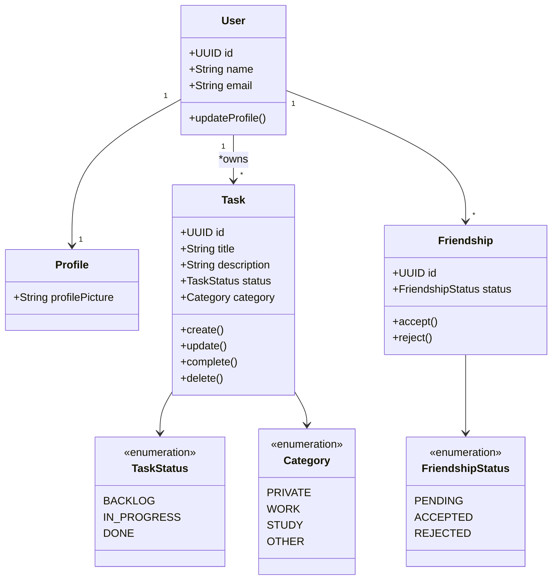
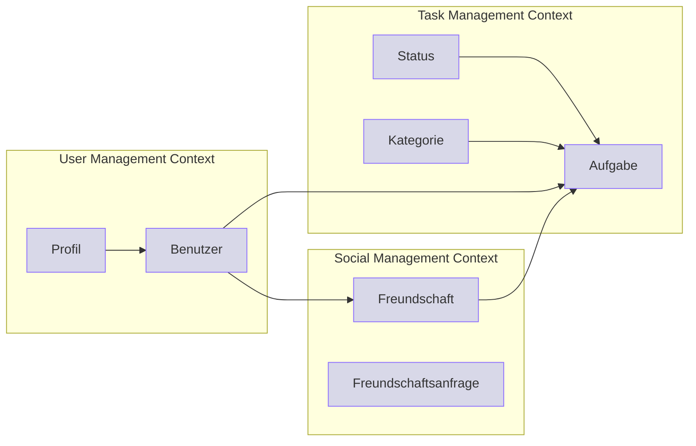
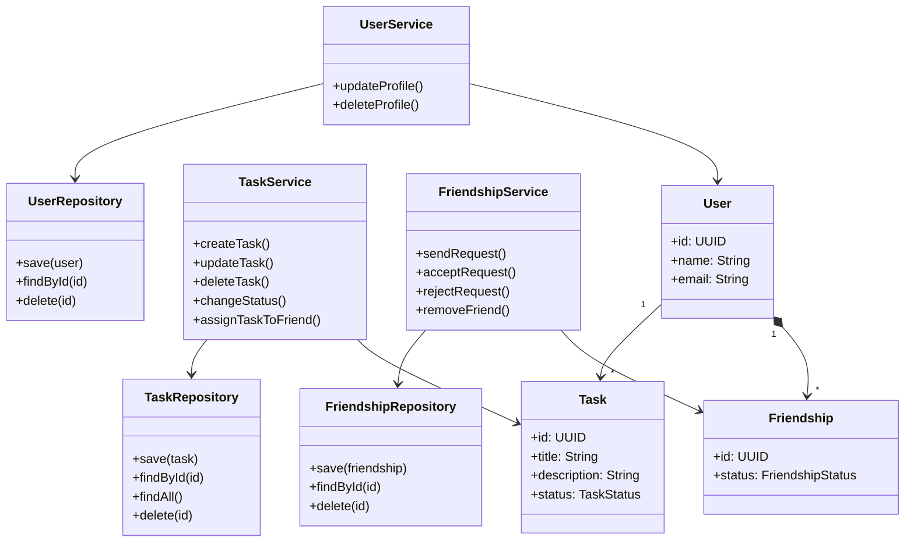
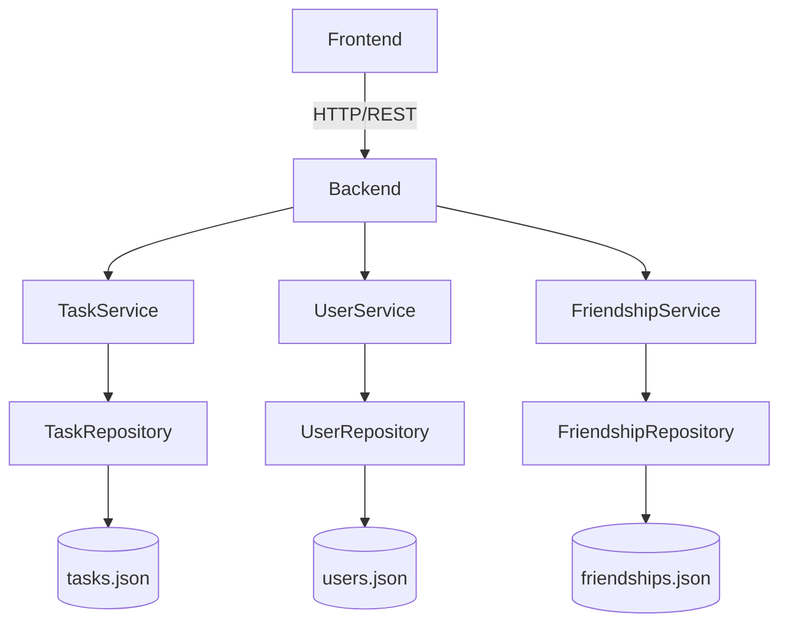

# Domänenmodell

## Herleitung aus dem Event Storming

Aus den identifizierten Events

- Aufgabe erstellt
- Aufgabe bearbeitet
- Aufgabe gelöscht
- Aufgabe erledigt
- Freund hinzugefügt
- Freund entfernt
- Profil bearbeitet

lassen sich die wichtigsten Konzepte der Domäne ableiten.

---

# Entitäten

Entitäten besitzen eine eindeutige Identität und existieren über einen längeren Zeitraum.

## Benutzer

Repräsentiert einen registrierten Nutzer der Anwendung.

Attribute:

- userId
- name
- email
- profilbild

---

## Aufgabe

Repräsentiert eine vom Benutzer verwaltete Aufgabe.

Attribute:

- taskId
- titel
- beschreibung
- status
- kategorie
- faelligkeitsdatum

---

## Freundschaft

Repräsentiert die Beziehung zwischen zwei Benutzern.

Attribute:

- friendshipId
- anfragenderBenutzer
- angefragterBenutzer
- status

---

# Werteobjekte (Value Objects)

Werteobjekte besitzen keine eigene Identität.

## Aufgabenstatus

Mögliche Werte:

- Backlog
- In Bearbeitung
- Erledigt

---

## Kategorie

Mögliche Werte:

- Schule
- Arbeit
- Privat
- Freizeit

---

## Freundschaftsstatus

Mögliche Werte:

- Angefragt
- Akzeptiert
- Abgelehnt

---

# Aggregate

Aggregate bilden fachliche Konsistenzgrenzen.

## Task Aggregate

Aggregate Root:

- Aufgabe

Enthält:

- Aufgabenstatus
- Kategorie

---

## User Aggregate

Aggregate Root:

- Benutzer

Enthält:

- Profilinformationen

---

## Friendship Aggregate

Aggregate Root:

- Freundschaft

Enthält:

- Freundschaftsstatus

---

# Beziehungen

- Ein Benutzer besitzt mehrere Aufgaben.
- Ein Benutzer kann mehrere Freundschaften besitzen.
- Eine Aufgabe kann einem Freund zugewiesen werden.

## Bounded Context

## Repositorys

## Implementierung
Backend
Json
Frontend
